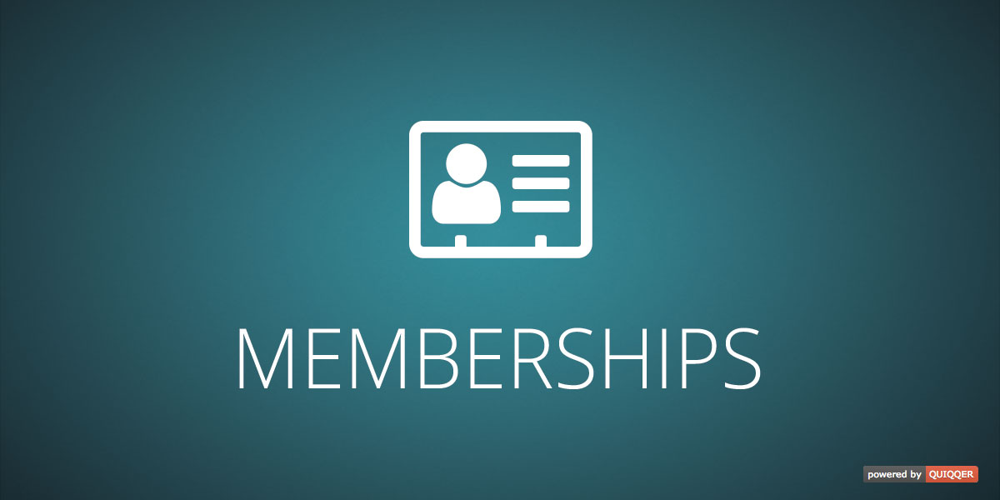

QUIQQER Memberships
========

Create and manage memberships for your users. With memberships you can grant your users permissions for set periods of time in your system. In conjunction with the QUIQQER ERP system, this module also enables automated linking of memberships with products, so that you can offer memberships for sale.

Package Name:

    quiqqer/memberships

Features
--------
* Create and manage individual memberships for QUIQQER users
  * A **membership** is a temporary assignment to one or more QUIQQER groups (which can have individual permissions)
* Membership as subscription: Set the time interval and if a membership shall renew itself automatically
* Track the membership of each user with an extensive history log
* Optional usage with QUIQQER ERP
  * Automatically create a product for each membership and offer your users the possibility to buy memberships

Installation
------------
The Package Name is: quiqqer/memberships

MCP tools
---------
The MCP provider requires `quiqqer.memberships.mcp`. Each write also checks the
corresponding membership permission for the MCP request user.

| Tool | Action | Additional permission |
| --- | --- | --- |
| `quiqqer_memberships_create` | Create a definition from `title` and `groupIds` | `quiqqer.memberships.create` |
| `quiqqer_memberships_delete` | Delete a definition with no active assignments, unless another user holds a lock | `quiqqer.memberships.delete` |
| `quiqqer_memberships_users_assign` | Assign a user and grant membership groups | `quiqqer.memberships.edit_users` |
| `quiqqer_memberships_users_extend` | Extend an active assignment by one cycle or to `endDate` | `quiqqer.memberships.edit_users` |
| `quiqqer_memberships_users_end` | Immediately archive an assignment and remove its exclusive groups | `quiqqer.memberships.edit_users` |

User tools accept `membershipId` (the definition ID) and `userId` (a QUIQQER user
ID or UUID). Duplicate assignments are rejected; use the extension tool instead.
Optional `endDate` uses `YYYY-MM-DD HH:MM:SS` in server local time and must be
later than the existing end date. Cancelled and infinite assignments cannot be
extended. Extensions record history and send the configured manual extension email.
Ending an assignment keeps its history and preserves groups granted by other
active memberships. These tools do not change linked ERP contracts.

New definitions default to one month without automatic renewal. Use the existing
`quiqqer_memberships_update` tool to configure duration, renewal and translations.
The existing group list, membership list and detail tools remain available.

Contribute
----------
- Project: https://dev.quiqqer.com/quiqqer/memberships
- Issue Tracker: https://dev.quiqqer.com/quiqqer/memberships/issues
- Source Code: https://dev.quiqqer.com/quiqqer/memberships/tree/master

Support
-------
If you found any errors or have wishes or suggestions for improvement,
please contact us by email at support@pcsg.de.

We will transfer your message to the responsible developers.

License
-------
PCSG QL-1.0, CC BY-NC-SA 4.0
